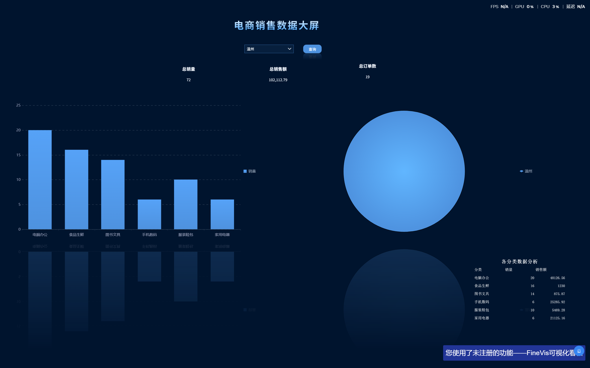
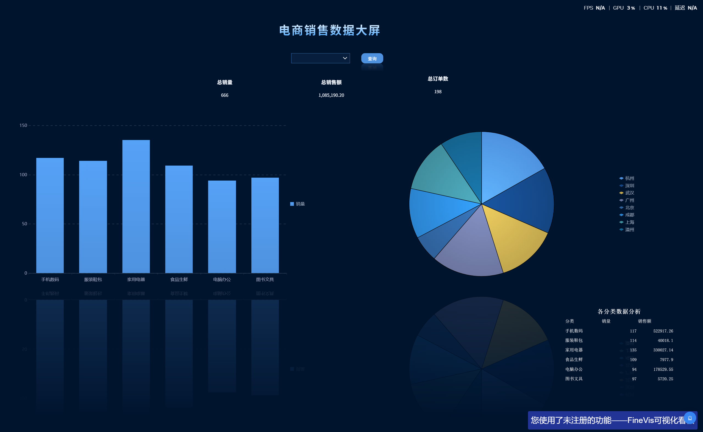

# 电商销售数据大屏（FineReport FineVis）

> 技术栈：FineReport 11.5 · FineVis 可视化看板 · SQLite · 达梦 DM8 · SQL
> 模板：F6_dashboard.fvs（SQLite）｜ F6_dashboard_dm.fvs（达梦）｜ 数据：orders_detail（198 行订单明细）

## 业务问题

运营团队需要一张**按城市查看销售大盘**的看板：打开就能看到核心指标（总销量/总销售额/总订单数），选择城市后，品类结构、城市占比、明细数据全部联动刷新——不需要懂 SQL 的业务人员自助取数。

## 数据

| 项 | 说明 |
|---|---|
| 数据源 | SQLite 数据库 `ecommerce_practice.db`（JDBC 连接，org.sqlite.JDBC） |
| 表 | `orders_detail`：198 行 × 15 列订单明细（订单/用户/商品/城市/品类/金额） |
| 口径 | 销售额 = `SUM(total_amount)`（成交额），非标价 |

## 处理（看板结构）

```
ds_sql（明细，带参数过滤）/ ds_city（城市选项）/ ds_sum_qty / ds_sum_total / ds_count_orders（聚合指标）
where ('${p_city}' = '' or city = '${p_city}')   ← 参数为空查全部
        │
        ├── 指标卡 ×3：总销量 666 ｜ 总销售额 ¥1,085,190.20 ｜ 总订单数 198
        ├── 柱形图：各品类销量（分类 category / 系列 quantity 求和）
        ├── 饼图：各城市销售额占比（分类 city / 系列 total_amount 求和）
        └── 表格：各分类数据分析（品类 / 销量 / 销售额）
```

交互：顶部下拉框（8 个城市）选城市 → 点查询 → **全部组件联动刷新**。

## 结论

- **品类两极分化**：手机数码（522,917）+ 家用电器（330,027）+ 电脑办公（178,530）三类贡献超 95% 销售额；服装鞋包/食品生鲜/图书文具合计不足 5.5 万
- **城市分布均衡但客单差异大**：杭州 18.2 万居首，广州/深圳紧随；北京销售额垫底（6.4 万）但销量 73 并不低 → 高价品类在杭州/广州成交更多
- **温州样本**：选温州后销售额 10.2 万、销量 72，品类结构与全量相似，未见区域特殊性

## 建议

1. 高价值品类（手机数码/家电）库存与服务资源向杭州、广州、深圳倾斜
2. 北京客单价偏低，可测试低价品类促销或高端品类投放策略调整
3. 图书文具等长尾品类以组合搭售维持曝光，不单独压库存

## 截图




> 使用 FineReport 学习版制作（未注册水印不影响功能演示）

---

# 国产数据库适配：同一张大屏，SQLite → 达梦 DM8

> 本文是 finereport-dashboard 仓库的补充章节。同一套 FVS 大屏（`F6_dashboard.fvs` SQLite 版 / `F6_dashboard_dm.fvs` 达梦版），数据源从 SQLite 平移到国产达梦 DM8，功能完全对齐。

## 业务背景

温州本地政企项目正在推进信创替代，数据库层的常见任务是：把跑在 MySQL/SQLite 上的报表系统平移到达梦/人大金仓等国产库上。这个项目用最小可行案例把这件事完整走了一遍：**一张带参数联动、图表和指标卡的决策大屏，两种数据库，同一套验收数字。**

## 改造清单

| 环节 | SQLite 版 | 达梦版 |
|---|---|---|
| 驱动 | sqlite-jdbc（帆软自带） | `DmJdbcDriver8.jar` 拷入设计器 `lib` 与 `webapps\webroot\WEB-INF\lib`，重启设计器 |
| 数据连接 | `org.sqlite.JDBC` | `dm.jdbc.driver.DmDriver` + `jdbc:dm://127.0.0.1:5236` |
| 建表/数据 | 单文件 .db | `01_create_table.sql` 建表 + 主键 `order_id`，INSERT 灌入 198 行 |
| 数据集 SQL | `where ('${p_city}' = '' or city = '${p_city}')` | **同款 SQL，一字不改**（见下方实证） |

大屏其余部分（FVS 组件、参数面板、联动）零改动——**应用层与数据库层解耦**正是报表工具 + JDBC 的价值。

## 实证一：`''` 是不是 NULL？不背结论，跑诊断

社区资料都说"达梦兼容 Oracle，`''` 当 NULL"，于是第一版数据集写了 `('${p_city}' IS NULL or ...)`，结果**参数为空时 0 行**。用两条诊断 SQL 审问数据库（DM8 2026-07 开发版实测）：

```sql
SELECT COUNT(*) FROM orders_detail WHERE '' IS NULL;      -- 0 行
SELECT COUNT(*) FROM orders_detail WHERE '' IS NOT NULL;  -- 198 行
```

结论：**该实例中 `''` 是普通空串，不是 NULL**。同一产品不同版本/兼容模式下，`''` 的语义可能相反——所以最终落库的 SQL 不赌任何一方的默认行为，两个分支都保留：

```sql
WHERE ('${p_city}' = '' OR city = '${p_city}')
```

## 实证二（更正版）：真凶是 `IS NULL`，不是参数引号

排障时曾把"联动失效"归因于参数引号写法——当时一次改了两处（`IS NULL` → `= ''`，同时去掉了引号），两个变量混在一起，归因错了。后来用**带引号**的完整版本做回归，空参/选城市两个分支在达梦上全部正常，证明：

- 带引号 `'${p_city}'` 在达梦连接上**没有问题**
- 真正导致空参 0 行的只有一处：`IS NULL` 在这版达梦上不成立（实证一）
- 结果是：**同一条 SQL，SQLite 和达梦通用，一字不改**——跨库适配的最理想形态

方法论教训写在这里引以为戒：**排障时一次只改一个变量**。两个变量一起动，归因就变成了猜——这个错误结论是我后来回头用带引号版本复测时才纠正过来的。

## 验收结果（双库逐项对数）

| 操作 | SQLite 版 | 达梦版 |
|---|---|---|
| 不选城市 | 666 / ¥1,085,190.20 / 198 | 666 / ¥1,085,190.20 / 198 ✅ |
| 下拉选 温州 | 72 / ¥102,112.79 / 19 | 72 / ¥102,112.79 / 19 ✅ |
| 下拉选 杭州 | — | 95 / ¥182,084.26 / 28 ✅ |

> 温州订单数以源数据为准：`select count(city) from orders_detail where city='温州'` = 19（72 件销量、¥102,112.79 由这 19 笔订单贡献）。早期记录曾把 66 误记为温州订单数，2026-10-31 已用源文件对账更正——**验收数字必须能追溯到源头数据**。




## 顺带收获：主键防重

迁移建表时给 `order_id` 加了主键（`ALTER TABLE ... ADD CONSTRAINT pk_orders_detail PRIMARY KEY (order_id)`，加约束前先用 `GROUP BY + HAVING` 验证过唯一性）。重跑整份 INSERT 脚本时达梦以 `-6602 违反唯一性约束` 逐条拦截，198 行数据零重复——约束不是给建表人看的，是给未来所有写数据的人看的。

## 复用说明

- `sql/dameng/`：建表、灌数、数据集 SQL（含本文两个实证的注释）
- 大屏文件：`F6_dashboard.fvs`（SQLite）/ `F6_dashboard_dm.fvs`（达梦）
- 诊断方法论：URL 直塞参数定位控件层 vs 数据集层；`'' IS NULL` 计数验证空串语义
